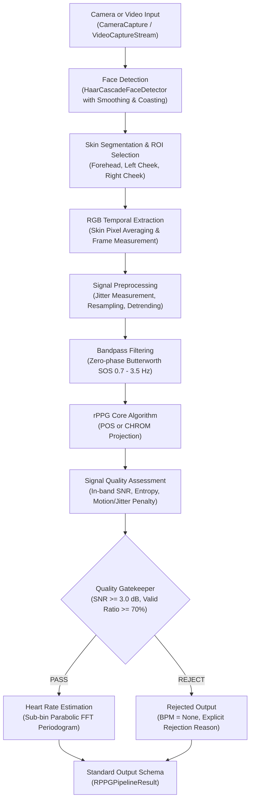

# SOMYTHRA Vision — Milestone R001
## Camera-Based Physiological Signal Processing Foundation

SOMYTHRA Vision R001 is a modular, testable, camera-based remote photoplethysmography (rPPG) signal-processing engine. It extracts subtle pulsatile blood-volume variations from facial skin regions in ambient video or live camera feeds, computes pulse waveforms, estimates resting heart rate (BPM), and performs rigorous signal-quality gatekeeping.

> [!IMPORTANT]
> **Research and Wellbeing Scope Only — Not a Medical Device**  
> SOMYTHRA Vision R001 is an exploratory physiological research foundation. It is **not** a diagnostic device, clinical monitor, or substitute for professional medical care. Ordinary RGB camera pulse extraction detects micro-blushes from volumetric blood displacement; it does **not** directly measure hemoglobin concentration, blood oxygen saturation ($SpO_2$), blood pressure, or blood glucose. Heart rate variability (HRV) metrics are intentionally excluded from R001 pending synchronized reference-grade ECG/PPG validation.

---

## 1. Architecture Overview

The pipeline processes video or live camera frames through a sequential, modular architecture:



### Module Organization

```
engine/
├── somythra/
│   ├── acquisition/
│   │   ├── camera.py          # Configurable webcam capture, monotonic timing, FPS
│   │   └── video.py           # Prerecorded video iteration, OpenCV backend
│   ├── vision/
│   │   ├── face_detection.py  # Face bounding box detection, smoothing, coasting
│   │   └── skin_roi.py        # YCrCb/HSV skin thresholding, forehead/cheek ROIs
│   ├── signals/
│   │   ├── rgb_extraction.py  # Multi-ROI pixel averaging, temporal buffer
│   │   ├── preprocessing.py   # Resampling, linear/MA detrending, normalization
│   │   ├── filtering.py       # Zero-phase SOS Butterworth bandpass (0.7-3.5 Hz)
│   │   └── synthetic.py       # Deterministic optical plethysmography signal generator
│   ├── algorithms/
│   │   ├── base.py            # BaseRPPGAlgorithm abstract class
│   │   ├── pos.py             # Plane-Orthogonal-to-Skin (Wang et al., 2017)
│   │   └── chrom.py           # Chrominance-based method (de Haan & Jeanne, 2013)
│   ├── physiology/
│   │   └── heart_rate.py      # FFT periodogram with parabolic sub-bin interpolation
│   ├── quality/
│   │   └── assessment.py      # Frequency-domain SNR, spectral entropy, tracking checks
│   ├── models/
│   │   └── schemas.py         # Structured dataclasses preserving modality and state
│   └── pipeline.py            # End-to-end RPPGPipeline orchestration
├── examples/
│   ├── generate_sample_video.py # Synthetic video generator for offline testing
│   └── run_rppg_analysis.py    # Standalone CLI tool with offline Matplotlib plotting
├── tests/                     # 24 deterministic automated unit and integration tests
├── pyproject.toml             # Project build configuration and dependencies
└── README.md                  # This documentation
```

---

## 2. Mathematical and Algorithmic Foundations

### Plane-Orthogonal-to-Skin (POS)
The POS algorithm (*Wang et al., IEEE TBME 2017*) projects normalized color signals ($C_n = [r_n, g_n, b_n]^T$) onto a plane orthogonal to the skin tone vector $P = [0, 1, -1]^T$:

$$\begin{aligned}
S_1 &= g_n - b_n \\
S_2 &= g_n + b_n - 2 r_n \\
\alpha &= \frac{\sigma(S_1)}{\sigma(S_2)} \\
H &= S_1 + \alpha S_2
\end{aligned}$$

Where $\sigma(\cdot)$ denotes the temporal standard deviation over a sliding window. This projection eliminates specular reflection under stationary lighting.

### Chrominance-Based Method (CHROM)
The CHROM method (*de Haan & Jeanne, IEEE TBME 2013*) projects normalized color variations onto chrominance difference signals:

$$\begin{aligned}
X_s &= 3 r_n - 2 g_n \\
Y_s &= 1.5 r_n + g_n - 1.5 b_n \\
\alpha &= \frac{\sigma(X_s)}{\sigma(Y_s)} \\
S &= X_s - \alpha Y_s
\end{aligned}$$

### Temporal Filtering & Sub-Bin Peak Interpolation
1. **Filtering:** Pulse waveforms are filtered using a 2nd-order zero-phase Butterworth filter via second-order sections (`scipy.signal.sosfiltfilt`). The passband is restricted to $0.7 - 3.5\text{ Hz}$ ($42 - 210\text{ BPM}$).
2. **Heart Rate Estimation:** Signals are zero-padded to 4096 points for dense FFT sampling. The dominant peak within the physiological band is refined using 3-point parabolic interpolation:
   $$\delta = \frac{A_{k+1} - A_{k-1}}{2(2 A_k - A_{k+1} - A_{k-1})}$$
   $$f_{\text{refined}} = f_k + \delta \cdot \Delta f$$
   $$\text{HR (BPM)} = f_{\text{refined}} \times 60$$

### Signal-to-Noise Ratio (SNR) Calculation
SNR is computed in the frequency domain as the ratio of power in the fundamental pulse harmonic (and its first overtone) within a $\pm 0.15\text{ Hz}$ window to the total non-pulse power across the physiological band:

$$\text{SNR}_{\text{dB}} = 10 \log_{10}\left(\frac{\int_{f_{\text{pulse}} \pm \Delta} P(f) df}{\int_{\text{band}} P(f) df - \int_{f_{\text{pulse}} \pm \Delta} P(f) df}\right)$$

Measurements with $\text{SNR} < 3.0\text{ dB}$ or valid skin frame ratio $< 70\%$ are **rejected**, returning `heart_rate_bpm = None` and a concrete rejection reason to prevent presenting fabricated or hallucinated readings.

---

## 3. Installation

SOMYTHRA Vision R001 uses standard scientific Python libraries.

### Requirements
- Python 3.10+ (tested up to Python 3.14.4)
- NumPy $\ge$ 1.24.0
- SciPy $\ge$ 1.10.0
- OpenCV (`opencv-python`) $\ge$ 4.7.0
- Pandas $\ge$ 2.0.0
- Matplotlib $\ge$ 3.7.0
- Pytest $\ge$ 8.0.0 (development)

### Installation Command
From the `engine` directory:

```bash
pip install -e .
# Or install with dev dependencies:
pip install -e .[dev]
```

> [!NOTE]
> **MediaPipe Compatibility Note:**  
> MediaPipe pre-built wheels are currently unavailable on upstream PyPI for Python 3.14+. SOMYTHRA R001 provides a robust, 100% offline Haar Cascade detector with temporal exponential smoothing and occlusion coasting by default. An abstract detector base class (`BaseFaceDetector`) enables dropping in MediaPipe or DLIB without pipeline changes when running in Python 3.10-3.12 environments.

---

## 4. Usage Guide

### A. Zero-Hardware Synthetic Simulation
Verify the entire pipeline end-to-end without a webcam or external video files:

```bash
python examples/run_rppg_analysis.py --synthetic --bpm 75.0 --algorithm pos --output synthetic_result.png
```

This runs a deterministic optical hemodynamic simulation ($R, G, B$ physiological micro-absorptions), detrends, filters, applies POS, verifies SNR, and saves a 4-panel diagnostic plot.

### B. Prerecorded Video File Analysis
Generate a sample video or supply your own:

```bash
# 1. Generate a 240-frame (8-second) synthetic test video:
python examples/generate_sample_video.py --output sample_video.mp4 --bpm 72.0 --duration 8.0

# 2. Run analysis on the video:
python examples/run_rppg_analysis.py --video sample_video.mp4 --algorithm pos --output video_result.png
```

Example terminal output:
```
======================================================================
               SOMYTHRA Vision R001 — Analysis Result                
======================================================================
  Session ID:          5cfbc2fa-cd70-4ba4-97ee-cba2d5e7a965
  Algorithm:           POS
  Processed Frames:    240
  Mean Sampling Rate:  30.00 Hz
  Signal Quality:      EXCELLENT (Score: 0.94)
  Frequency SNR:       12.32 dB
  Status:              PASS
----------------------------------------------------------------------
  ESTIMATED HEART RATE: 72.1 BPM
  Confidence:           98.5%
======================================================================
```

### C. Live Camera Acquisition
Run real-time capture from a local camera device:

```bash
python examples/run_rppg_analysis.py --camera 0 --duration 10.0 --algorithm pos --output live_result.png
```

**Camera Guidelines:**
- Ensure the face is evenly illuminated with diffuse, indirect lighting.
- Avoid intense backlighting or flickering fluorescent lights.
- Minimize head movement, talking, or swallowing during the 8–10 second recording window.
- The pipeline processes frames locally in memory; no facial images or raw video files are uploaded or persisted.

---

## 5. Automated Test Suite

Run the full pytest suite from the `engine` directory:

```bash
pytest tests
```

### Test Coverage Highlights
- `tests/test_models.py`: BoundingBox geometry, ROI sets, schema validation, serialization.
- `tests/test_signals.py`: Non-uniform timestamp handling, interpolation, motion disturbance detection, zero-phase Butterworth filtering, Nyquist frequency guards.
- `tests/test_algorithms.py`: Independent mathematical verification of POS and CHROM on synthetic hemodynamics.
- `tests/test_physiology_quality.py`: Parabolic peak interpolation, frequency-domain SNR, gatekeeper rejection under white noise and motion.
- `tests/test_pipeline.py`: End-to-end pipeline execution with clean signals, noisy signals, and missing data.
- `tests/test_video_pipeline.py`: Full video file streaming through Haar face detection, skin masking, and pulse extraction.

---

## 6. Current Limitations and Mitigations

| Area | Current Limitation | Engineering Mitigation in R001 |
|---|---|---|
| **Motion Artifacts** | Rigid head movement causes large intensity shifts that swamp rPPG signals. | Frame-to-frame variance checks detect motion bursts and penalize signal quality; tracking coasts through brief occlusions. |
| **Variable Lighting** | Ambient light fluctuation or PWM LED flicker introduces spurious spectral peaks. | POS and CHROM color difference projections neutralize stationary specular reflections; SNR thresholds reject unconfident peaks. |
| **Short Duration** | Recordings under 5 seconds lack frequency resolution for sub-BPM precision. | Pipeline requires at least 4.0 seconds ($> 100$ samples at 30 Hz); shorter clips are flagged as insufficient. |
| **Melanin & Skin Tone Diversity** | Higher melanin concentrations attenuate pulsatile green reflection. | Multi-ROI pooling (forehead + cheeks) and CHROM/POS projection utilize normalized chrominance differences rather than raw green intensity alone. |
| **Frame Dropping** | Variable camera framerates produce uneven temporal grids. | Continuous cubic/linear timestamp-aware resampling reconstructs a strictly uniform temporal grid before FFT processing. |

---

## 7. Future Hardware Expansion Roadmap

SOMYTHRA Vision R001 was designed with an extensible modular interface (`BaseRPPGAlgorithm`, `FrameRGBMeasurement`, `TemporalRGBSignal`) to support upcoming hardware modalities:

1. **Near-Infrared (NIR) Optical Sensors:**
   - 850 nm and 940 nm illumination allows pulse extraction in zero-lux environments and exhibits lower sensitivity to skin pigmentation variations.
2. **Thermal Imaging Sensors:**
   - Long-wave infrared (LWIR) sensing enables superficial vascular tracking and core thermal distribution mapping invariant to visible lighting changes.
3. **ESP32 & Embedded Edge Capture:**
   - Microcontroller-based camera nodes (e.g. ESP32-S3 Cam) streaming lightweight ROI pixel statistics rather than raw video, preserving network bandwidth and edge privacy.
4. **Multimodal Reference Fusion (ECG & Contact PPG):**
   - Synchronized ground-truth ingestion to benchmark remote optical estimates against clinical gold standards under controlled exercise and resting protocols.
